# SPARK-SMI

> A terminal-based system monitor (TUI) built for **NVIDIA Grace Blackwell (GB10)** and hybrid ARM architectures — because `nvidia-smi` alone doesn't tell the full story.


---

## Demo

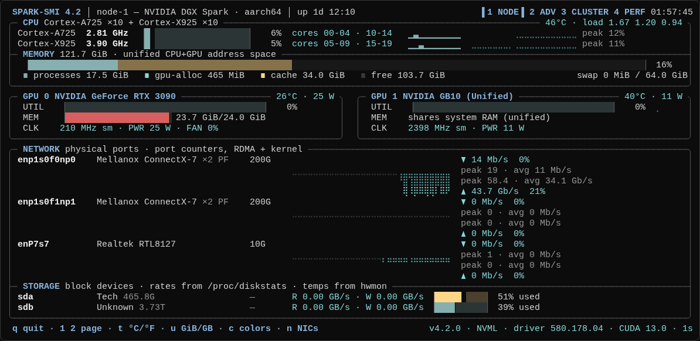

Live mode on a DGX Spark with an RTX 3090 attached: the overview, three of
the color themes (one `c` keypress each), then the two-node cluster view,
with an iperf3 run on the first ConnectX-7 port. Everything on screen is
real hardware telemetry; nothing in this project is mocked or simulated. The
node names are set with `--node-name` (see [Display names](#display-names)).

---

## Why SPARK-SMI?

The NVIDIA DGX Spark (GB10) is a unique system — a Grace Blackwell chip with
unified CPU+GPU memory, hybrid Cortex-X925/A725 core clusters, and high-speed
MT2910 200G networking. Standard tools like `nvidia-smi`, `htop`, and `nvtop`
were not built with this topology in mind. SPARK-SMI was — but it's not
hardcoded to it. Every piece of layout is driven by what the box in front of
it actually reports, so the same binary also renders something sane on a
plain x86 desktop with one consumer GPU.

| What it handles correctly | Standard tools |
|:---|:---:|
| Hybrid P-core / E-core CPU clusters grouped by actual silicon type | ❌ |
| GB10 unified memory (CPU+GPU shared) shown as real numbers, not `N/A` | ❌ |
| RDMA/RoCE-aware NIC bandwidth (bypasses the kernel netdev counters) | ❌ |
| A unified-memory SoC and a discrete card side by side, each accounted correctly | ❌ |
| Negotiated PCIe link state for every endpoint, flagged only when it's a fault | ❌ |
| A whole cluster on one screen | ❌ |
| NVML with graceful `nvidia-smi` fallback | ✅ |

**Dependencies, honestly.** The dashboard itself needs two Python packages —
`psutil` and `nvidia-ml-py` — and nothing else; that covers CPU, memory, GPU,
network, storage, thermals, and PCIe on a stock Linux install.

Individual features do reach outside that, and each is capability-gated —
the tool isn't there, the feature isn't shown, nothing crashes:

| Feature | Needs |
|:---|:---|
| Per-field GPU fallback, clock/persistence knobs | `nvidia-smi` (ships with the driver) |
| Power rails + `PL1`/`PL2` knobs (page 2) | the out-of-tree [`spark_hwmon`](https://github.com/antheas/spark_hwmon) `spbm` module |
| Fabric bandwidth/latency tests (page 4) | `perftest` (`ib_write_bw`/`ib_write_lat`), or `iperf3` for non-RDMA rails |
| Cluster and fabric modes | passwordless (`BatchMode=yes`) SSH between nodes |
| Fuller NIC model names | `/usr/share/hwdata/pci.ids`, if installed |
| Live mode on Windows | `windows-curses` |

---

## Five pages

**Page 1 — Overview** (`1`): CPU clusters with per-core load, MEMORY with a
segmented used/cache/free bar, one card per GPU (utilization, memory, clocks,
power), NETWORK (physical ports, RX/TX bars, or mirrored RX/TX history when
there is room), STORAGE (block devices, temperature, R/W rates, usage). This is the "glance at it and know the
system's state" page. On a terminal of 200 columns or more it uses the whole
screen: dials, charts with axes and minutes of history (see "Big screens"
below).

**Page 2 — Advanced** (`2`): per-GPU detail (clocks, PCIe generation/width/
throughput, power vs. limit, thermal trip points, throttle reasons,
persistence/compute-mode/ECC state, running processes), a **PCIE LINKS**
panel covering every PCIe endpoint in the system — storage/NVMe, network,
GPU — regardless of what's actually plugged into a given slot (see "PCIe
link monitoring" below), per-PF NIC detail (RDMA counters, CNP/ECN marks,
discards, ASIC temperature), every thermal zone and named hwmon device, and
NVMe SMART health. This is also where the interactive power/clock knobs
live (see below). On a big terminal it adds history charts for all of it
(see "Big screens" below).

**Page 3 — Cluster** (`3`, needs `--cluster`): every node in the cluster on
one screen, each section (CPU / MEMORY / GPU / FABRIC / STORAGE) stacking one
row per node so you compare members down a column instead of tabbing between
hosts. When the terminal has rows to spare, a TOPOLOGY map opens above them:
each node as a box, each fabric link as a line with its live traffic. Up to
8 nodes it's a sections view; beyond that it becomes a compact fleet matrix
plus an alerts panel. `↑`/`↓` (or `←`/`→`) selects a node and `Enter`
drills into that node's page 1. On a terminal of 200 columns or more, up to
8 nodes get the whole screen: cluster dials, the map, a column of charts per
node and a GPU heat grid (see "Big screens" below). See "Cluster mode"
below.

**Page 4 — Fabric validation** (`4`, needs `--cluster` with 2+ members): the
one page that *actuates*. It runs real RDMA bandwidth and latency tests
between nodes — per rail, node-to-node, or all nodes at once — and charts the
result live while correlating each NIC's ASIC temperature against sustained
load. Every run is behind an explicit confirm. See "Fabric validation" below.

**Page 5 — GPU tasks** (`5`): every process
holding a GPU context, as a tree. Each GPU is a root; below it, processes are
grouped by where they live — a tmux pane, a screen session, a docker
container, a systemd unit, an ssh login or a plain terminal — and processes
whose parent or login session is gone are flagged **orphaned**. Columns show
the user, each process's own **SM %** and **encoder / decoder %**, CPU,
resident memory, GPU memory and age (fewer at narrow widths), plus a
two-minute SM sparkline on wide terminals. SM, ENC and DEC appear only where
the driver reports them per process (NVML's process utilization). `s` sorts
by GPU memory, SM, CPU, run time or PID; `f` switches between the session
tree and one flat list per GPU; `/` filters by PID, name, command line, user
or session (`Enter` keeps the filter, `Esc` clears it).

Below the tree, a **PROCESS** pane describes the selected process: its full
command line, session, user and parent, start time and threads, working
folder, the GPU-selection variables `CUDA_VISIBLE_DEVICES`,
`NVIDIA_VISIBLE_DEVICES`, `CUDA_DEVICE_ORDER`, `NCCL_IB_HCA` and
`NCCL_SOCKET_IFNAME` (no other variable is ever read out), the GPU and RDMA
device files it holds open, and charts of its SM, GPU memory and CPU. For
another user's process the folder, variables and device files need root,
and the pane says so. A **RECENTLY ENDED** list keeps the last hour of
processes that left a GPU, with how long each ran and its peak SM and
memory. The history behind the charts and that list is kept in memory from
the moment spark-smi starts, on every page, and never goes over the network.

`Enter` opens the selected session (attaches to the tmux pane or screen
session, or tails the unit's journal or the container's log); `e` ends a
process or a whole session through its own manager (`tmux kill-pane`,
`docker stop`, `systemctl stop`), `k` kills it with SIGKILL. Ending anything
asks `y`/`N` first. A process owned by another user needs passwordless sudo,
and another user's tmux server cannot be attached. `a` also lists processes
that only hold `/dev/nvidia*` open (monitoring tools, an idle CUDA context).
Snapshot mode (`--page 5`) shows the same tree read-only.

In cluster mode, page 5 lists this machine's processes first, then each
other node's, under rows such as `node-2 · GPU 0`. Another node shares its
list only when its agent runs with `--share-tasks` (see "Other nodes' GPU
tasks" below); a node that doesn't gets one line saying why. Other nodes'
rows are **read-only**: `e`, `k` and `Enter` only say so, because a PID
from another machine means nothing here. End or open them on their own node.
The filter also matches node names.

### History graphs

CPU clusters and GPUs carry a braille graph of up to the last 40 samples
(40 seconds at the default refresh; live mode, or snapshot mode with
`--warmup`). The scale is fixed at
0-100%, so a tall bar always means a busy part, and each cell brightens with
its value in five steps from the theme's graph colour, so a spike stands
out even at the edge of your vision. Any activity keeps at least the bottom
dot lit, and the peak of the samples shown is printed beside the graph
(`peak 82%`), where the row has room.

When the terminal has rows to spare, page 1's NETWORK and STORAGE rows open
up into a **mirrored history**: download (or disk reads) rises above a faint
baseline and upload (or writes) hangs below it, each half scaled to its own
recent peak, with the current rate on the outer rows and the peak and
average of the window beside the inner ones. Each half's scale never drops
below 1% of the link speed (10 MB/s for disks), so an idle port stays flat
instead of magnifying noise. A mirrored row takes four lines; NICs get them
first, then disks, and on a short terminal the rows stay one line each, as
before. A disk's usage bar moves under its name.

### Big screens

On a terminal of **200 columns and 45 rows or more** (a full-screen terminal on
a 1080p monitor is about 240 × 67), page 1 stops at no width cap and uses the
whole screen (a live capture is under "Screenshots"):

- **AT A GLANCE**: a strip of dials across the top: CPU, memory, each GPU's
  utilization and power, system power (with the `spbm` driver), fabric
  throughput, the hottest sensor, the hottest disk and disk use. A dial
  appears only for a number this machine reports.
- **CPU + MEMORY** and the **GPUs** side by side, each with charts that have
  a value axis and a time axis. GPUs with a power limit also chart their
  power.
- **NETWORK + STORAGE** across the full width, each port and disk with a
  mirrored chart and its scale.
- At **300 columns or more** (about a 1440p monitor), a third column,
  **POWER & THERMAL**, lists every power rail and temperature sensor with
  its own history, and the CPU panel adds a per-core heatmap: one row per
  core, so a pinned core shows as a bright streak. It always lists every
  core: when the column is short, the cores wrap into two or more
  side-by-side columns, and with no room for all of them it is left out.

Charts start at a few rows and grow until the page fills the terminal, so
no row is left blank. They show the last **5 minutes** (10 at 300+
columns). `+` and `-` step the window through 1, 5, 10 and 30 minutes and
1 hour; the history is kept in memory from the moment spark-smi starts,
so a fresh start fills in from the right.

`g` cycles the graph size: **auto** (the big layout when the terminal is big
enough), **large** (also a one-column big layout on terminals of 120-199
columns, when it fits), and **compact** (the normal page at any size).
`--graphs` and `--history` set the same from the command line. spark-smi
remembers your last `g` and `+`/`-` choice in
`~/.config/spark-smi/settings.json` (or under `$XDG_CONFIG_HOME`).

`L` cycles the big layouts' preset (`--preset` on the command line):

- **auto**: the layout described here.
- **graphs**: no dial strip on page 1 or page 3; the charts take its rows.
- **dials**: bigger dials, and every dial this machine has, on two rows
  when one is not enough.
- **dense** (page 1): today's panels in two columns: page 1's on the left,
  page 2's (GPU detail, NIC ports, PCIE LINKS, THERMALS, POWER RAILS,
  NVME SMART) on the right, read-only. A panel that does not fit is left
  out whole. Best on a wide terminal that is not very tall.

To choose page 1's dials and their order, add a `"dials"` list to the
settings file. spark-smi keeps it when it saves your key choices:

```json
{
 "preset": "auto",
 "dials": ["cpu", "memory", "gpu0.util", "gpu0.power", "system.power", "fabric", "hottest"]
}
```

The names are `cpu`, `memory`, `gpuN.util`, `gpuN.power` (N is the GPU's
number in the header), `system.power`, `fabric`, `hottest`, `disk.temp` and
`disk.used`. A dial this machine has no sensor for is skipped. If the file
is not valid JSON, spark-smi runs on its defaults, says why in the footer
(on stderr in snapshot mode) and never writes over the file; a value it
does not know falls back to its default the same way.

Page 2 has one too (a live capture is under "Screenshots"):

- **One column per GPU**: the same detail as the normal page, knobs
  included, then charts beneath it: SM clock against its maximum, power
  against its limit, temperature, and PCIe traffic in and out. A chart
  appears only for a number this GPU reports.
- **NIC** and **PORTS** side by side: the per-PF table, and a mirrored
  in/out chart for each physical port (its PFs summed) with a
  **CONGESTION** chart of CNP and ECN marks per second.
- **THERMALS** as a heat grid: one row per sensor over time, so a sensor
  that warms up shows as a brightening streak. When the page is short, the
  sensors wrap into side-by-side columns.
- **POWER RAILS** with a wall-power chart (with the `spbm` driver), then
  **PCIE LINKS** and **NVME SMART**.

Page 2's big layout needs this machine's own history, so a drilldown into a
remote node keeps the normal page 2.

Page 5 has a big layout at the same sizes: one card per GPU across the top,
each charting **SM by process** (the three busiest) and **GPU memory by
process**, stacked, so a steady climb shows a leak; below them the task tree
with its SM sparklines, and the PROCESS pane with its charts on the right
(a live capture is under "Screenshots").

Page 3 (cluster mode, up to 16 nodes) has one too:

- **CLUSTER**: dials for the GPUs' average and the slowest GPU, the
  cluster's power (wall power with the `spbm` driver, otherwise the GPUs'
  draw), memory, fabric throughput, the hottest sensor and where it is,
  agents answering, and the fullest disk.
- **TOPOLOGY**: the map from the normal page, at the largest size that
  still leaves the charts room.
- **One column per node**, in the fewest rows (up to four) that keep each
  column wide enough for its charts: each GPU's utilization chart, CPU with
  memory, the node's power and its fabric traffic as a mirrored in/out
  chart, all on one time axis, then the GPU processes using the most memory
  (up to three). With room to spare, a column adds a memory chart and a
  HOTTEST chart (the hottest of its CPU, GPUs and NIC). A node with several
  GPUs splits its GPU chart height among them, so it keeps the same charts
  as its neighbours. A node that stops answering keeps its column, saying
  how long it has been silent.
- **GPU UTIL**: a heat grid with one row per GPU in the cluster, so a GPU
  that lags the others stands out. On a taller terminal it becomes **HEAT**
  and adds a row per node for fabric use (as a % of link speed), then one
  for CPU.

`v` cycles page 3's view (`--view` on the command line): **map+graphs**
(the layout above), **map** (the map, with the heat grid filling the rows
beneath it) and **heat** (the heat grid alone, each row drawn up to three
lines tall). A cluster with no heat grid (fewer than two GPUs) keeps
map+graphs. The view is remembered like the other choices.

The cluster history is kept by the machine drawing the page, from its own
polls. Until it has more than a minute, the charts show the minute each
node's sample already carries. The map or the heat grid is left out when the
terminal is too short for them; with more than 16 nodes, page 3 keeps its
fleet matrix.

Page 4 (fabric validation) has one too:

- **FABRIC TEST** across the top, the same controls as the normal page.
- **BANDWIDTH**, the per-rail chart of the running or last pair, as tall
  as the page allows, beside **RAILS** (the last run's result per rail)
  and **FABRIC NOW**: every node's fabric traffic in and out over the
  history window, so a test's load, or anyone else's, shows on every node
  at once.
- **MATRIX**, the all-pairs grid, beside **RUN HISTORY**: the newest
  results from the results file, newest first, with each run's total, its
  slowest and fastest rail and its round trip.

The page only displays, as before: a run still starts with `space` and a
`y` at the confirm.

Below 200 columns, and in a node drilldown on a smaller terminal, page 1 is
the same as before. A drilldown into a remote node on a big terminal uses
the big layout with that node's last minute of history; the long history is
kept only on the machine that draws it and never goes over the network.

### PCIe link monitoring

Any PCIe slot can carry more than one kind of device over its lifetime — on
the reference DGX Spark this project runs on, the M.2 slot currently holds an
external RTX 3090 instead of the boot NVMe (which moved to a USB enclosure).
SPARK-SMI doesn't care which occupant is in a slot: page 2's PCIE LINKS panel
walks every endpoint under `/sys/bus/pci/devices` (storage, network, GPU) and
reports its negotiated link generation/width against its own declared
maximum, whatever the device happens to be.

This matters because of a known failure mode: a GPU can enter a power-draw
safety mode where its link downtrains to gen1 ×4 **and stays there under
load**. A plain idle downtrain (any PCIe device dropping link speed to save
power while idle) is completely normal and shown only as a dim
`idle downtrain` note. SPARK-SMI only raises the loud
`⚠ gen1 under load — power safety mode?` alert (red, on both the PCIE LINKS
row and that GPU's page-2 detail panel, plus a page-1 GPU-card warning row)
once the low-generation state has persisted for 3+ consecutive samples
*while the GPU is genuinely busy* (util ≥20%) — so a routine idle dip never
false-positives, but a GPU wedged at gen1 mid-workload gets flagged loudly
and stays flagged until it recovers.

---

## Capability-driven, not hardcoded

Every collector probes what the hardware actually supports **once**, at
startup, into a small `.caps` dict, and the page builders consult it before
drawing anything. A missing sensor doesn't print `N/A` in a field that looks
broken — the field is simply absent.

The clearest example is the fan. On the GB10 (and any SoC matching the
unified-memory heuristic below), there is no independent fan controller NVML
or `nvidia-smi` can query — `caps["fan"]` comes back `False`, and the GPU
card's `FAN` field is dropped from that row entirely rather than showing a
permanent, misleading `0%` or `N/A`. Drop the same code onto a machine with a
real fan-equipped GPU and the field reappears on its own — nothing about the
rendering path changed, only what the probe returned.

The same pattern holds everywhere: `power_draw`/`power_limit` are probed
independently (GB10 reports draw but not limits), `mem_local` flips to
`False` on any GPU name matching `GB\d{2,3}` (unified memory — system RAM is
shown instead, with "(Unified)" appended to the name), `pcie`/`clocks` gate
the page-2 detail rows, and `spbm`/RDMA/SMART availability each gate their
own panels or rows the same way. Page 2's power/clock **knobs** go a step
further and gate on *writability*, not just readability — see "Power tuning
notes" below.

---

## Universal hardware detection

Nothing about topology is assumed; it's discovered at import/startup:

- **CPU clusters** — cores are grouped by actual silicon type: ARM MIDR
  (implementer + part, translated to marketing names like Cortex-X925) on
  ARM, `/sys/devices/cpu_core`/`cpu_atom` masks for Intel P/E hybrids, or one
  flat "CPU Cores" group otherwise. Interleaved core layouts (the real DGX
  Spark alternates A725/X925 across the core ID space) are handled — the
  per-core grid shows absolute core IDs, not a relabeled contiguous range.
- **GPUs** — NVML first, CLI (`nvidia-smi --query-gpu`) fallback per field,
  "N/A" only as a last resort. Multiple GPUs of different architectures (a
  GB10 iGPU alongside a discrete card) render side by side without either
  needing special-case code.
- **NICs** — physical interfaces come from `/sys/class/net`, hardware names
  come from PCI vendor/device IDs (`/sys/class/net/<i>/device/vendor|device`)
  against a small built-in table (Mellanox, Realtek, Intel, Broadcom,
  MediaTek, Aquantia, NVIDIA) with a `/usr/share/hwdata/pci.ids` lookup and
  then the kernel driver name as further fallbacks — so an unrecognized NIC
  still gets a sensible label instead of nothing. Multi-port cards (e.g. a
  dual-port ConnectX-7) are grouped by PCI slot into one row.
- **Storage** — every physical block device under `/sys/block` (loop/ram/dm
  devices skipped), model/size from sysfs, temperature from whichever hwmon
  matches it (NVMe controllers), usage from the largest mounted partition's
  `statvfs`.
- **Thermal zones** — every `/sys/class/thermal` zone plus every named
  `/sys/class/hwmon` device's temperature channels. Zones sharing a generic
  type (several unlabeled `acpitz` zones, as on GB10) are relabeled
  Zone-A/Zone-B/… in zone order so they stay distinguishable.

---

## Density tiers

The layout re-evaluates every frame against the terminal's current width —
resize the window and it adapts live, no restart needed:

| Tier | Width | Behavior |
|:---|:---|:---|
| `compact` | < 84 cols | Condensed layout: two NIC/disk entries per cell-row, GPU fields folded onto fewer lines. |
| `standard` | 84–110 cols | Full field set, but GPU cards and THERMALS/SMART stack full-width instead of side-by-side. |
| `wide` | > 110 cols | The full multi-column layout; content is capped at 160 columns and centered on wider terminals. |
| `large` | ≥ 200 cols, ≥ 45 rows | Pages 1 to 5: dial strips, charts with axes and minutes of history across the full width (see "Big screens"). |
| `xl` | ≥ 300 cols, ≥ 45 rows | `large` plus, on page 1, a POWER & THERMAL column and a per-core heatmap. |

Resizing is live — the same running process, no restart, reflowing between
wide, standard, and compact as the window changes. Every width below shows a
*complete* page; the layout condenses (two NICs per row, CPU clusters onto
one line) rather than clipping anything away:

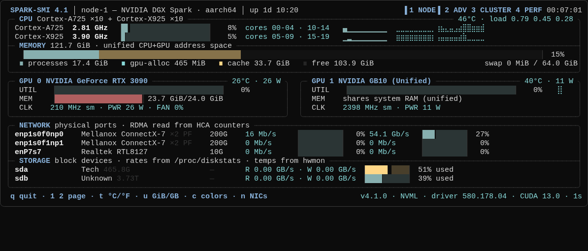

If a tier's content still doesn't fit the available height, things degrade
further in this order: sparklines drop first, then the memory legend row,
then NIC rows collapse into a single summary line. Page 2 measures what is
left for THERMALS and fits it: more sensors per row first, then without the
duplicate Zone-A… group (once the spbm driver names its own sensors), then
without bars, then PCIE LINKS lists only links below full speed, then
POWER RAILS shows only its main rails. If that is still too tall, a last
line says how many sensors are hidden.

Bar rendering itself has a separate three-tier auto-detection (sub-cell
`eighths` resolution on UTF-8 terminals, whole-cell `blocks` on framebuffer
consoles whose font lacks eighth-block glyphs, or plain-ASCII `[|||  ]`
forced by `--ascii`, a non-UTF-8 stdout, or `SPARK_SMI_ASCII`) — independent
of the density tier, since it's about glyph support, not screen space.

---

## The RDMA/HCA-counter story

On a machine with RDMA-capable NICs (Mellanox ConnectX and similar), GPU
traffic over RoCE/NCCL/GPUDirect bypasses the kernel's normal network stack
entirely — it never touches the netdev's `rx_bytes`/`tx_bytes` counters that
`psutil`, `ifconfig`, or `ip -s link` read. A monitor that only reads netdev
counters will show near-zero traffic on a link that's actually saturated.

SPARK-SMI uses three counter sources and takes the best one available:

| Source | Counts | Where |
|:---|:---|:---|
| Physical-port MAC counters (`OctetsReceivedOK` / `OctetsTransmittedOK`, read over ethtool netlink) | every frame on the wire, RDMA and kernel alike | NICs whose driver reports the IEEE 802.3 MAC counters (mlx5 does), Linux 5.13 or later |
| HCA port counters (`/sys/class/infiniband/<hca>/ports/<n>/counters/port_rcv_data`, `port_xmit_data`) | RoCE/RDMA traffic; on some builds kernel traffic too | any RDMA device |
| netdev counters (psutil, `/sys/class/net/<if>/statistics`) | kernel traffic only | every NIC |

The HCA counters are in **4-byte-word units** (per the InfiniBand spec),
multiplied by 4 to get bytes. The MAC counters are the same numbers
`ethtool -S <if> --groups eth-mac` prints, and reading them needs no root.

Every tick, per netdev, each direction takes the larger of the HCA delta and
the netdev delta. Per physical port, page 1 then takes the larger of the MAC
counter delta and the sum of its netdevs' rates. PFs that share one physical
port (the DGX Spark's ConnectX-7 exposes two per port) read the same MAC
counter, so a port counts once, never once per PF. RX and TX stay separate
rates throughout, and a counter reset from a driver reload is clamped to zero
instead of showing a giant negative-delta spike.

Why all three: on some driver and firmware builds the HCA counters count
only RDMA traffic, never traffic sent through the kernel. On a DGX Spark with
kernel `7.0.0-1025-nvidia` and ConnectX-7 firmware 28.50, a 109 Gb/s iperf3
run left them at 0, while a 109 Gb/s `ib_write_bw` run raised them by the
same byte count as the port's MAC counter. With TCP (49 Gb/s) and RDMA
(61 Gb/s) on one port at once, the per-netdev rule alone reads about
60 Gb/s; the MAC counter reads the full 112 Gb/s (#11).

The NETWORK panel's caption says which case applies:

| Caption | Meaning |
|:---|:---|
| **port counters, RDMA + kernel** | every RDMA-backed port has MAC counters: mixed traffic reads in full |
| **RDMA read from HCA counters** | no MAC counters; TCP alone and RDMA alone read right, both at once read as the larger |
| **HCA counters read 0, kernel traffic only** | no MAC counters, and no HCA counter has moved since boot |

Page 2's per-PF rows use a port's MAC counter only when that PF is the
port's sole PF; a shared port's counter is the sum of all its PFs, so those
rows keep the per-netdev rule. Page 4's fabric tests sample these per-PF
rates, so a test's RDMA traffic is measured either way.

Page 2's NIC panel goes further: per-PF congestion/ECN counters (CNP sent/
handled, ECN marks, buffer discards) straight from the same `hw_counters`
directory, plus ASIC temperature from the NIC's own hwmon device.

---

## Keys

| Key | Page | Action |
|:---:|:---:|:---|
| `q` | all | Quit |
| `1` / `2` | all | Switch page (overview / advanced) |
| `5` | all | GPU tasks page (this machine's processes; in cluster mode, then other nodes' shared ones, read-only) |
| `3` | all | Cluster page (only live with `--cluster`; inert otherwise) |
| `4` | all | Fabric validation page (only live with `--cluster` and 2+ members; inert otherwise) |
| `t` | all | Toggle temperature units (°C / °F) |
| `u` | all | Toggle memory units (GiB / GB, decimal) |
| `c` | all | Cycle color theme (see "Themes" above; capital `T` is an undocumented alias) |
| `S` | all | Save the screen as an SVG picture in the current folder, named `spark-smi-page<N>-<date>-<time>.svg` |
| `?` | all | Toggle the help overlay (any key dismisses it) |
| `n` | 1 | Show active NICs only |
| `s` | 1 | Sort NIC rows by current rate (max of RX/TX), descending — toggle back to detection order |
| `g` | 1 / 3 / 5 | Graph size: auto / large / compact (see "Big screens"); remembered |
| `+` / `-` | 1 / 3 / 5 | History window of the big layouts' charts: 1m, 5m, 10m, 30m, 1h; remembered |
| `L` | 1 / 3 | Layout preset of the big layouts: auto / graphs / dials / dense; remembered |
| `v` | 3 | Big cluster page view: map+graphs / map / heat; remembered |
| `Tab` | 2 | Select GPU (when more than one) |
| `P` | 2 | Focus/cycle the power-limit knob (GPU limit → PL1 → PL2 → SYSPL1 → SYSPL2, as available) |
| `C` / `M` | 2 | Focus the SM / memory clock-lock knob |
| `R` | 2 | Arm a clock reset (confirm required) |
| `X` | 2 | Toggle GPU persistence mode (confirm required) |
| `←` / `→` | 2 | Step the focused knob's pending value |
| `Enter` | 2 | Apply the focused knob (raises a `y`/`N` confirm) |
| `Enter` | 3 | Drill into the selected node's page 1 (remote sample; knobs disabled) |
| `↑` / `↓`, `←` / `→` | 3 | Select a node |
| `a` | 3 | Fleet matrix (>8 nodes) only: show alerting nodes only |
| `o` | 3 | Fleet matrix only: cycle sort column (name / GPU / power / alerts-first) |
| `Esc` | 2 / 3 | Cancel the pending step or confirm (page 2) / back out of a node drilldown to the cluster page |
| `space` | 4 | Start a fabric test (raises a `y`/`N` confirm) / stop one immediately, no confirm needed to abort |
| `m` | 4 | Cycle test mode: one pair / all-pairs sweep / all-nodes burst |
| `d` | 4 | Cycle test duration: 10s / 30s / 60s per pair |
| `↑` / `↓` | 4 | Select which pair to run (pair mode only) |
| `↑` / `↓`, `PgUp` / `PgDn` | 5 | Select a row (GPU, session or process); page keys move 10 rows |
| `Enter` / `o` | 5 | Open the selected session: attach to its tmux pane or screen session, or tail its journal or docker log |
| `e` | 5 | End the selected process (SIGTERM) or session (its manager's stop) — raises a `y`/`N` confirm |
| `k` | 5 | Kill the selected process or session (SIGKILL / `docker kill` / `systemctl kill`) — raises a `y`/`N` confirm |
| `a` | 5 | Also list processes that only hold `/dev/nvidia*` open |
| `s` | 5 | Sort processes: GPU memory / SM % / CPU % / run time / PID |
| `f` | 5 | Flat list per GPU (the session shows in brackets) / back to the session tree |
| `/` | 5 | Filter by PID, name, command line, user, session or node; type, then `Enter` keeps it, `Esc` clears it |
| `Esc` | 5 | Cancel the pending confirm, else clear the filter |

Page 5 can end other people's work: `e` and `k` stop running GPU jobs, and
unsaved work in them is lost. Nothing is signalled until you press `y` at the
prompt; any other key cancels.

Page 4 (fabric validation) is confirm-gated for a reason: it drives real RDMA
traffic between nodes and can saturate the fabric. See "Fabric validation"
below before running one on a shared cluster.

Knobs only ever appear when they're actually writable for the hardware in
front of you (see "Power tuning notes"), and applying one always goes through
an explicit confirm prompt before anything is written. Knobs are always
local-only: drilling into a remote node's page 2 (cluster mode) shows that
node's data read-only, with a "knobs are local-only" note in the footer.

---

## Themes

Ten named colour themes — `spark` (green, the original default), `nord`
(blue), `dracula` (magenta), `solarized` (cyan), `gruvbox` (yellow), `mono`
(greyscale), `amber`, `ice` (cyan), `sunset` (magenta), `cyber` (cyan) — plus
`terminal`, which draws with your terminal's own 16 colours so spark-smi
matches whatever theme the terminal already uses.

- `--theme <name>` picks one for the session; `--theme list` (or `--themes`)
  prints the names and exits.
- `$SPARK_SMI_THEME` sets the default when `--theme` isn't passed.
- In live mode (`-l`), the `c` key cycles through them (wrapping back to
  `spark` after `terminal`) — a footer toast confirms the new name for a few
  ticks. Lowercase `c` is deliberate: it's distinct from page 2's capital
  `C` (SM clock-lock knob focus), so theme cycling works on both pages
  without stealing that binding. Terminals below 256-color fall back to
  each theme's basic-8 approximation automatically.

### Readable on dark and light terminals

Every theme is measured against the terminal's background, not hand-picked
for a dark one. Text stays at **4.5:1** contrast or better (the WCAG AA
level), graph marks at **3:1**, and frames and empty bar tracks sit in a
quiet band (1.3 to 3:1) so they never shout over the numbers. A colour that
misses its floor moves only as far as it must and snaps to the nearest
xterm-256 colour that passes; a unit test holds every theme to these floors.

spark-smi works out the background by itself:

| Order | Source |
|:---:|:---|
| 1 | `--background dark` or `light` (or `$SPARK_SMI_BACKGROUND`) |
| 2 | the terminal's answer to an OSC 11 query (its exact background colour) |
| 3 | `$COLORFGBG` |
| 4 | dark |

On a light background the neutral inks swap lightness (bright text becomes
dark text) and the coloured ones darken, keeping their hue. `--shot`
pictures use the dark palette unless `--background light` is given, so a
picture looks the same whoever makes it. The `terminal` theme is not
measured: your terminal's theme owns those colours.

```bash
spark-smi --theme nord
spark-smi --theme list
SPARK_SMI_THEME=dracula spark-smi -l
spark-smi --theme terminal -l
spark-smi --background light --page 2 --shot page2-light.svg
```

---

## CLI flags

```
spark-smi [options]

  -l, --loop       live mode: curses TUI, refreshed continuously
  -n <secs>        refresh rate in seconds (default: 1)
  -p, --page <n>   which page to render in snapshot mode: 1 overview (default),
                   2 advanced (GPU detail, NIC/thermal/SMART panels),
                   3 cluster (requires --cluster), 4 fabric validation
                   (requires --cluster with 2+ members; snapshot mode only
                   ever shows the last recorded run -- it never starts one),
                   or 5 GPU tasks (read-only in snapshot mode)
  --theme <name>   color theme (default: spark; or $SPARK_SMI_THEME)
  --theme list     print the available theme names, one per line, and exit
  --background auto|dark|light
                   which ground the theme is measured against (default auto:
                   ask the terminal, then $COLORFGBG, else dark; or
                   $SPARK_SMI_BACKGROUND). Pictures (--shot) use dark
                   unless this says light
  --ascii          force plain-ASCII bars/frames (no UTF-8 box drawing)
  --shot FILE.svg  snapshot mode: write the page as an SVG picture instead of
                   printing it (complete page, any width; see --size)
  --size COLS[xROWS]
                   snapshot mode: render at this size instead of the
                   terminal's (ROWS defaults to the terminal's height, or
                   with --shot to the whole page)
  --warmup SECS    snapshot mode: sample once a second for SECS first, so
                   history graphs have data (0-120, default 0)
  --graphs MODE    page 1's graph size: auto (default; the big-screen
                   layouts on terminals of 200+ columns and 45+ rows),
                   large (also a one-column big layout from 120 columns),
                   or compact (the 160-column page at any size). The `g`
                   key cycles it live; the choice is remembered
  --history SPAN   how far back the big layouts' charts reach, 10s to 1h
                   (e.g. 90s, 5m, 1h; default 5m, 10m at 300+ columns).
                   The +/- keys step it live; the choice is remembered
  --preset NAME    the big layouts' preset: auto (default), graphs (no
                   dials), dials (bigger dials, every one shown) or dense
                   (page 1: today's panels with page 2's beside them).
                   The `L` key cycles it live; the choice is remembered
  --view NAME      page 3's big layout: map+graphs (default), map (the map
                   with the heat grid under it) or heat (the heat grid
                   alone). The `v` key cycles it live; remembered
  --json           print one sample as JSON (+ node/model/version/ts) and exit
  --serve [PORT]   read-only HTTP sample server (default port 8817);
                   GET /sample, GET /healthz. A token in the file named by
                   $SPARK_SMI_TOKEN_FILE (or, older setups, $SPARK_SMI_TOKEN)
                   is required as the X-Spark-Token header on /sample
  --serve-verbose  log one line per request to stderr (--serve only)
  --share-tasks    with --serve or --json: add this node's GPU processes
                   (session, user, numbers; no command lines) to the
                   payload, so other nodes' page 5 lists them read-only.
                   Off by default; --serve refuses it without a token
  --share-args     with --share-tasks: include command lines too. They can
                   carry passwords or keys: share only on a trusted network
  --node-name NAME show NAME instead of this machine's hostname: in the
                   header, in --json and --serve's payload, and so on every
                   cluster page (or $SPARK_SMI_NODE_NAME; 1-63 letters,
                   digits, '-' or '_')
  --cluster HOSTS  cluster mode: page 3 shows every node in HOSTS (comma-
                   separated "host"/"host:port"/"ssh:host" entries, or
                   "@file" -- one entry per line, # comments). Bare
                   --cluster (no value) tries ~/.config/spark-smi/cluster
  -h, --help       show this help and exit
  -V, --version    print the version and exit
```

An option spark-smi does not know, or a stray word, stops it with a one-line
message naming it (exit code 1), so a typo never quietly runs another mode.

Snapshot mode (no `-l`) renders once and prints ANSI to stdout — pipe it, log
it, script it, same as `nvidia-smi`.

---

## Cluster mode

Point one `spark-smi` at several nodes and page 3 turns into a fleet view:

```bash
# on each node you want to monitor from elsewhere:
spark-smi --serve                      # serves GET /sample + /healthz on :8817

# on the node you're watching from:
spark-smi -l --cluster node-1,node-2,node-3,node-4
spark-smi -l --cluster @~/.config/spark-smi/cluster   # or bare --cluster to try that path
spark-smi --cluster node-1,node-2 --page 3            # one-shot snapshot (2s poll cap)
```

- `host` polls `http://host:8817/sample`; `host:port` overrides the port;
  `ssh:host` falls back to `ssh -o BatchMode=yes host spark-smi --json` per
  tick — fine for bootstrapping a small cluster, not a substitute for
  `--serve` at any real scale. The entry matching the local hostname reads
  the local dashboard's own state directly instead of going over the
  network.
- Up to 8 nodes: a SECTIONS view, one row per node under CPU / MEMORY / GPU /
  FABRIC / STORAGE. More than 8: a FLEET matrix (one compact row per node)
  plus an ALERTS panel (unreachable · temp ≥ 80°C · CNP storm · link down ·
  disk ≥ 85%).
- Bars and history graphs widen with the terminal; the graphs run to the
  right edge, and the CPU, MEMORY and GPU graphs start in one column.
- The TOPOLOGY map (sections view only) uses the rows the sections leave
  free; in a terminal too short for it, the page is the sections alone. See
  "Topology map" below.
- On 200+ columns and 45+ rows, up to 16 nodes get the big layout: dials,
  the map, a chart column per node and a GPU heat grid, with up to an hour
  of history kept by the viewer (see "Big screens" above).
- A node that stops answering is marked stale (dim "unreachable Ns" row with
  its last-seen values) after 3× the poll interval — the render loop never
  blocks on the network; it always draws whatever the background poller last
  collected.
- A shared token, if set, is sent as the `X-Spark-Token` header on every
  poll and required by `--serve` on the polled side. Both ends read it the
  same way.

### Topology map

The map draws each node as a box (GPU, CPU and memory use, the hottest
sensor, and power: the `spbm` wall input where present, otherwise the GPUs'
draw) and each fabric link as a line between boxes.

- **Links are found, not configured.** Each node reports its RDMA ports'
  IPv4 address and prefix. Two nodes with a port on the same network are
  cabled together; a network three or more nodes share is a switch, drawn
  as one bus they all hang off. A node on an older version sends no prefix
  and is read as /24.
- **Two nodes cabled directly** sit side by side with one line per rail
  (`p0f0`, `p0f1`, … as on page 4) and that rail's traffic each way:
  `▸112G ◂117M` reads left to right, then right to left.
- **More nodes** sit in a row (two rows when they don't fit). Neighbours'
  links run across the gap between them; other links and switches run along
  tracks beneath the boxes, labelled with their traffic.
- **Line weight and colour follow load:** dim when idle (under 1 Mb/s),
  graded colour when busy, heavy at half the link's speed or more; red for a
  rail without carrier. A node that stops answering keeps its lines, dimmed,
  labelled `no data`.
- The selected node's box takes the accent colour, as its rows do below.
- Nodes are mapped in name order, whatever the sections' sort.

### Display names

Every screen shows the machine's hostname: page 1's header, and each node's
row on pages 3 and 4 (taken from the `node` field of its `/sample`). To show
another name, for example before sharing a screenshot, set one per node:

```bash
SPARK_SMI_NODE_NAME=node-1 spark-smi --serve
spark-smi -l --node-name node-1 --cluster node-1,node-2
```

- `--node-name` wins over `$SPARK_SMI_NODE_NAME`; with neither, the hostname
  shows as before.
- A name is 1-63 letters, digits, `-` or `_`, starting and ending with a
  letter or digit. Anything else stops spark-smi with the reason.
- Set it on the polled node's `--serve` too, since that node's payload
  carries the name the watching node shows. An `ssh:host` member runs
  `spark-smi --json` over ssh, which sees only that login's environment.
- Only the display changes. The cluster list still uses real host names, the
  local entry is still found by the real hostname, and fabric tests still
  connect to the hosts in the list.
- Fabric results record the names shown at the time of the run, so a
  renamed node's earlier runs keep its old name.

### Shared token

Keep the token in a file that only the user running `spark-smi` can read,
and point `$SPARK_SMI_TOKEN_FILE` at it on every node:

```bash
install -d -m 700 ~/.config/spark-smi
python3 -c 'import secrets; print(secrets.token_urlsafe(32))' > ~/.config/spark-smi/token
chmod 600 ~/.config/spark-smi/token
SPARK_SMI_TOKEN_FILE=~/.config/spark-smi/token spark-smi --serve
```

Copy the same file to each node, and set the same variable where you run
`--cluster`. In a container, use a Docker secret
(`SPARK_SMI_TOKEN_FILE=/run/secrets/spark_smi_token`). Under systemd, use
`LoadCredential=` (`SPARK_SMI_TOKEN_FILE=%d/token`).

- Trailing whitespace and newlines in the file are ignored.
- If the file is missing, unreadable or empty, `--serve` and `--cluster`
  exit with the reason. They never run without the token you asked for.
- `$SPARK_SMI_TOKEN` (the token itself in the environment) still works for
  older setups, but other processes of the same user can read it from
  `/proc`. Set one variable, not both.

### Other nodes' GPU tasks

An agent never sends its process list unless you ask. To let other nodes'
page 5 list this node's GPU processes, start its agent with `--share-tasks`:

```bash
SPARK_SMI_TOKEN_FILE=~/.config/spark-smi/token spark-smi --serve --share-tasks
```

- `--serve --share-tasks` refuses to start without the shared token, so the
  list is never open on the port.
- It sends, per GPU process: PID, name, user, CPU, resident memory, GPU
  memory, SM / encoder / decoder %, age, and the kind and name of its
  session (tmux, docker, systemd, ssh, terminal). It does **not** send
  command lines, working folders, environment variables, or the handles
  page 5 uses to end or open a session.
- Add `--share-args` to send each command line too. A command line can
  carry a password or an API key, so do this only on a network you trust.
- Viewers see the processes read-only, and the sample is taken at most
  once a second however many viewers poll.
- An agent older than 5.6 cannot share; page 5 names its version.

---

## Fabric validation

Page 4 (`4`, live mode, `--cluster` with 2+ members) drives real RDMA/network
stress tests between cluster nodes and shows the results live: a per-rail
bandwidth chart, HCA ASIC temperature correlated against sustained load, and
an all-pairs latency/bandwidth matrix with an anomaly callout for a cable or
transceiver that's dragging the fleet down.

**This page ACTUATES.** Unlike every other page in spark-smi, opening it
doesn't just read sensors — pressing `space` and confirming with `y` starts a
test that saturates the fabric between the nodes involved. Nothing runs on
its own:

- Snapshot mode (no `-l`) only ever shows the **last recorded run** — there
  is no code path from `--page 4` to starting a test.
- Live mode requires the explicit `space` → `y`/`N` confirm sequence (same
  ethos as the page-2 power/clock knobs). The confirm prompt warns when any
  cluster member's GPU looks busy (>10% util or a running compute process),
  so you don't accidentally flood the fabric under someone else's job.
- `space` again while a test is running stops it immediately — no confirm
  needed to abort — and tears down every server/client process it started,
  on every node involved.

**Requirements**: `perftest` (`ib_write_bw`/`ib_write_lat`) on every node for
RDMA rails — falls back to `iperf3` for a rail with no RDMA device. The
*viewing* node also needs passwordless (`BatchMode=yes`) SSH to every other
member; a node testing against itself, or the local node acting as one side
of a pair, runs the command locally instead of over SSH.

**Modes** (`m` cycles): `pair` (one src→dst, all its rails in parallel),
`sweep` (every ordered pair, sequentially — the default), `burst` (every node
pushes to its ring successor simultaneously; the aggregate is the sum of
everything observed at once). Duration (`d` cycles): 10s / 30s / 60s per
pair.

Results are appended to `~/.local/share/spark-smi/fabric-tests.jsonl` (one
JSON line per completed pair) so the MATRIX panel and page-4's idle state
survive a restart — the bandwidth/temperature numbers come from the same
RDMA HCA counters and per-rail ASIC temp page 2 already reads, sampled once a
second during the run; perftest's own summary line is parsed only as a
secondary cross-check, never the primary source.

```bash
# on the node you'll drive tests FROM, in addition to the cluster-mode setup above:
ssh-copy-id node-2     # and every other member -- BatchMode=yes SSH must work unattended
sudo apt install perftest   # or iperf3, for rails with no RDMA device

spark-smi -l --cluster node-1,node-2,node-3,node-4
# press 4, then space, then y to run the default all-pairs sweep
```

---

## Screenshots

Captured on two DGX Sparks, one with an RTX 3090 attached, in the `nord`
theme, with the node names set with `--node-name`: pages 1 and 2 with
spark-smi 4.2 during an iperf3 run on the first ConnectX-7 port, written by
`--shot` itself; page 3 with 4.4 during an `ib_write_bw` run on one rail,
saved with the live `S` key.

### Make your own

spark-smi draws its own pictures. `--shot` writes a page as SVG instead of
printing it, always the complete page, at any width:

```bash
spark-smi --page 2 --size 130 --warmup 10 --node-name node-1 --shot page2.svg
```

`--warmup 10` samples for ten seconds first, so the history graphs have
data, and `--node-name` keeps your real host name out of the picture. In
live mode, `S` saves the screen as it is. Frames, bars and braille graphs
are drawn as shapes, so they line up in any viewer whatever fonts it has;
text stays selectable. A page is about 20-45 KB.

**Page 1 — Overview.** Hybrid Cortex-X925/A725 clusters, unified memory split
into process/GPU/cache segments, both GPUs side by side, and mirrored
upload/download history for every NIC port and disk.

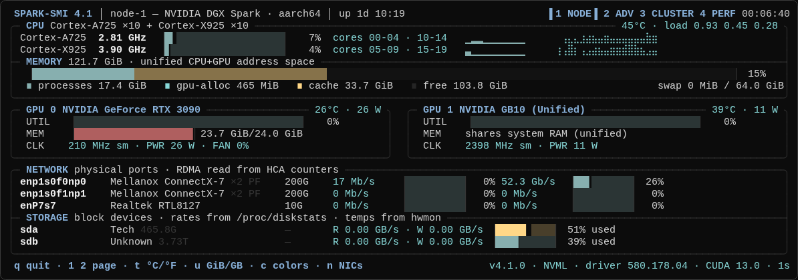

**Page 1 on a big screen.** The same page in a 240 × 67 terminal (full
screen at 1080p): the AT A GLANCE dials, then each CPU cluster and each GPU
charted over the last 10 minutes (`+` raised it from the default 5),
with value and time axes, and a mirrored
chart for every port and disk. Here the RTX 3090 eGPU runs a job near its
350 W limit while the GB10 idles. Captured live with 5.0 and the `S` key.

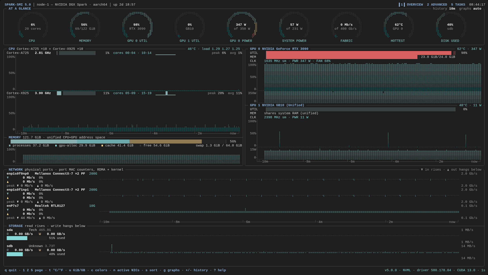

**Page 2 — Advanced.** Per-GPU clocks/PCIe/throttle/process detail, every
PCIe endpoint's negotiated link state, per-PF RDMA and congestion counters,
every thermal zone, NVMe SMART, and the `spbm` power rails with their knobs.

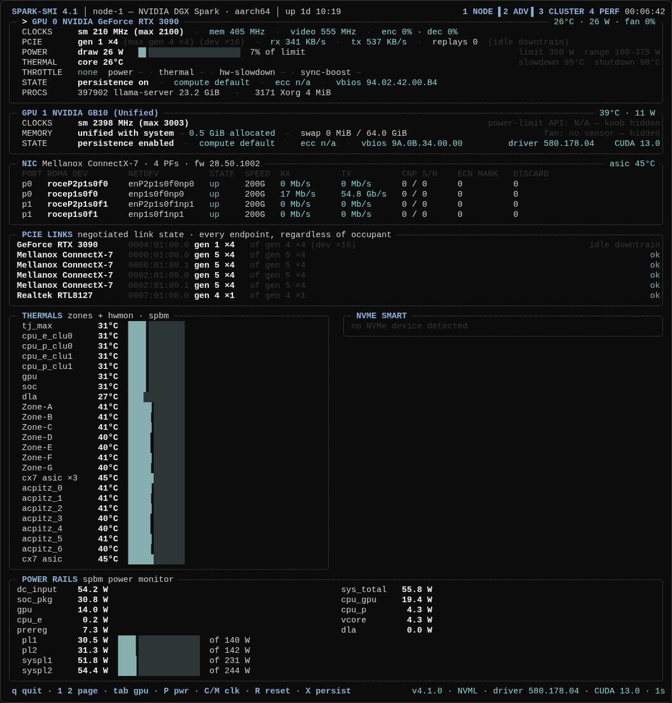

**Page 2 on an ultrawide screen.** The same Spark at 380 × 75, with the
RTX 3090 and the GB10 both busy and one rail carrying a two-way RDMA run at
108 Gb/s: clock, power, temperature and PCIe charts under each GPU's
detail, the port's mirrored chart, every sensor's heat row and the wall
power. Captured live with 5.4 and the `S` key; the host name was replaced
before publishing.

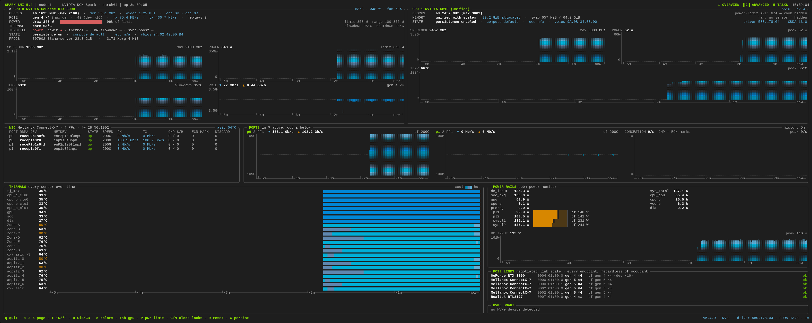

**Page 3 — Cluster.** The TOPOLOGY map on top: two Sparks cabled directly
over four rails, one carrying an RDMA run. Below it, the two nodes compared
down each column, with a mixed-GPU fleet summary and per-node totals in the
section headers.

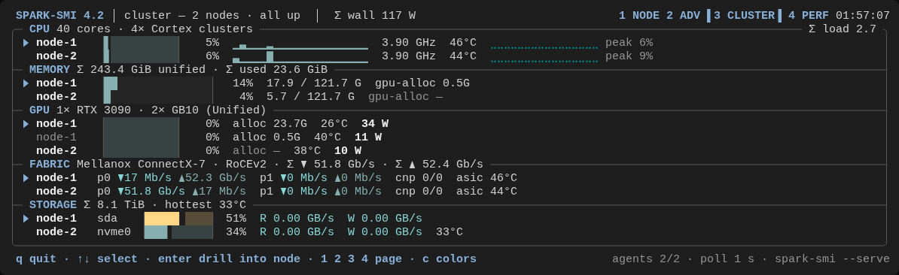

**Page 3 on a big screen.** The same two Sparks at 240 × 67: the CLUSTER
dials, the map with one rail carrying a two-way RDMA run at 108 Gb/s each
way, then a column per node charting each GPU, CPU, wall power and fabric
over the last 5 minutes, and the GPU UTIL grid showing when each GPU got
busy. Both GB10s run a test load next to the RTX 3090's own job. Captured
live with 5.2 and the `S` key; host names were replaced before publishing.

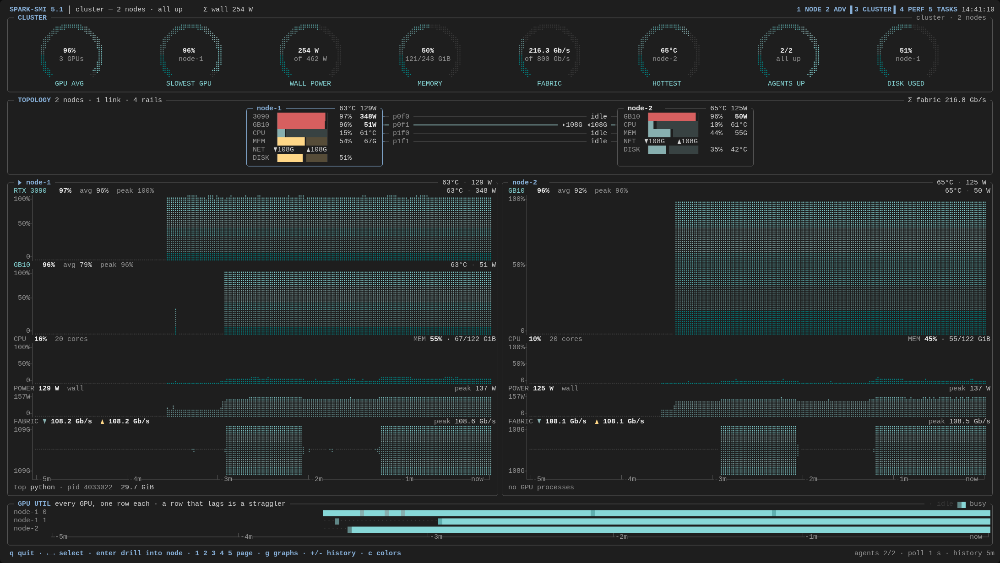

**Page 3 on an ultrawide screen.** The same two Sparks at 380 × 75, about
a 3440 × 1440 monitor at full screen. Each column adds a memory chart, a
HOTTEST chart and the three GPU processes using the most memory; node-1
splits its GPU rows between the RTX 3090 and the GB10, so its column keeps
the same charts as node-2's. The grid at the bottom is now HEAT, with a row
per node for fabric use and for CPU under the GPU rows. Captured live with
5.3 and the `S` key; host and process names were replaced before
publishing.

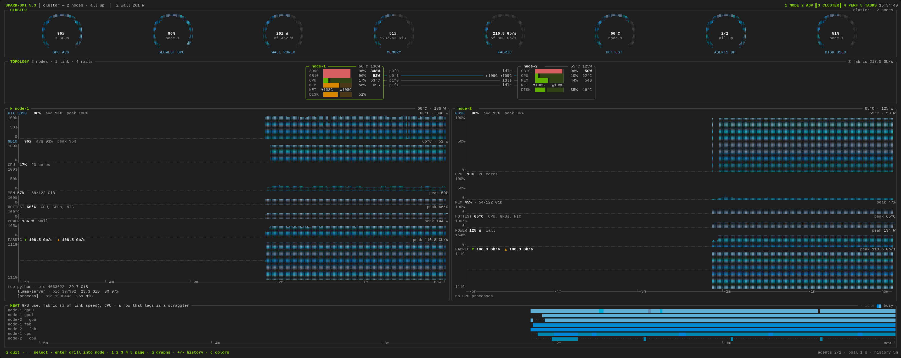

Nothing about that view is DGX-specific. It has run across a deliberately
mismatched fleet — an x86_64 AMD EPYC server with no usable NVIDIA driver
alongside two aarch64 Sparks — with 72 cores and 998 GiB summed across three
machines, ConnectX-4 and ConnectX-7 on the same fabric row, and a GPU
section that counts `1× RTX 3090 · 2× GB10` rather than assuming they're all
alike.

**Page 4 — Fabric validation.** Four rails driven concurrently, charted live,
with ASIC temperature tracked across the run and an all-pairs
bandwidth/latency matrix. Between two Sparks it measured about 55 Gb/s per
rail with a 2.5 µs round trip: four rails sharing one PCIe gen5 ×4 uplink,
which is exactly the kind of ceiling this page exists to expose. Captured
with 4.3 after a 10-second all-pairs sweep, saved with the live `S` key.

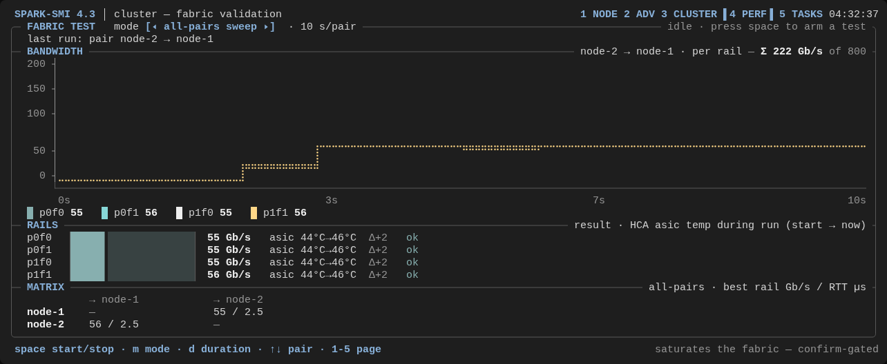

**Page 4 on an ultrawide screen.** Two Sparks at 380 × 75 with one rail
carrying a two-way RDMA run: the last pair's per-rail chart, every node's
fabric traffic in and out, the matrix and the run history. The matrix says
"no data" because the recorded runs used an earlier name for the second
node. Captured live with 5.5 and the `S` key; host names were replaced
before publishing.

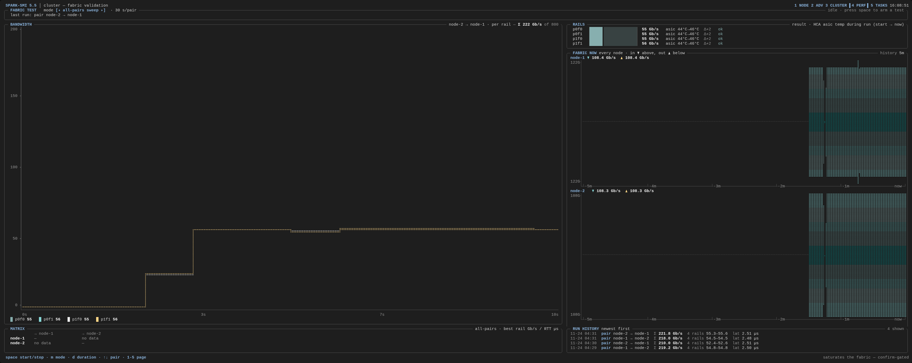

**Page 5 — GPU tasks.** Every GPU process under its GPU, grouped by where it
runs: a tmux server, a docker container, the desktop's terminal. The eGPU
and the GB10 each get their own tree, with each process's SM %, a
two-minute SM sparkline, and the PROCESS pane below for the selected one (a
test load here). RECENTLY ENDED folds a health check that runs every few
seconds into one line. Captured live with 5.1 at 150 × 45 with the `S` key;
host, account names, the model path, a command's arguments and the
container name were replaced with `[markers]` before publishing.

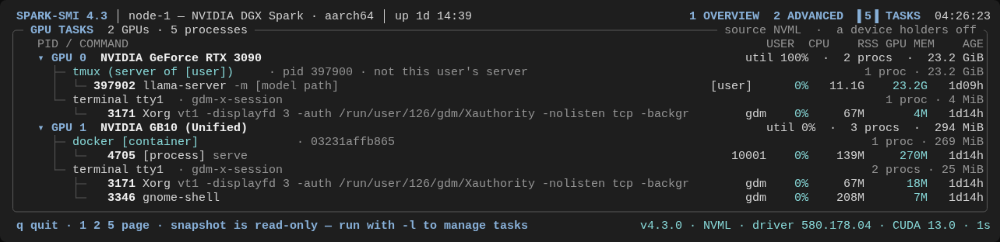

**Page 5 on a big screen.** The same machine at 240 × 67: SM by process and
GPU memory by process for each GPU over the last 5 minutes, the task tree,
and the PROCESS pane with its charts. Captured live with 5.1, redacted the
same way.

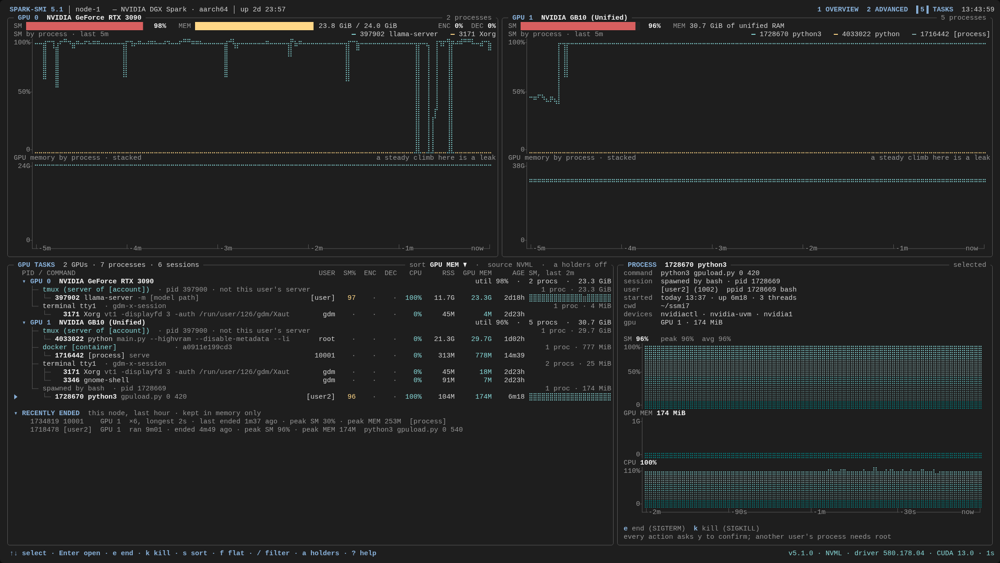

**Page 5 in cluster mode.** The local node's GPU processes, then node-2's,
shared by its agent with `--share-tasks` (no command lines). A node-2
process is selected: the pane marks it read-only and shows what was
shared. Its SM column reads `-` because that node's agent has no NVML
bindings, so it cannot report per-process SM. Captured live with 5.6 at
160 × 45 with the `S` key; account names, the model path, a command's
arguments, the process and the container name were replaced with
`[markers]` before publishing.

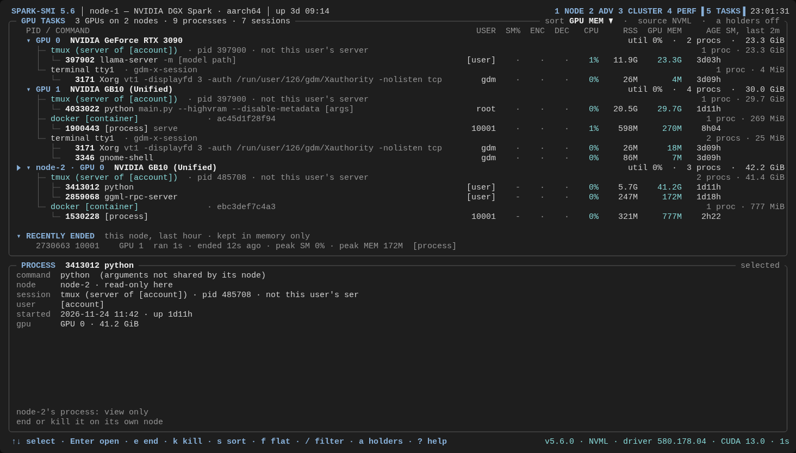

---

## Prerequisites

- **Linux** for full fidelity — the collectors read `sysfs`, `hwmon`,
  `/proc`, and `/sys/class/infiniband`. aarch64 and x86_64 both work.
- **Python 3.8+** (developed and tested on 3.12, the DGX Spark's system
  Python).
- **NVIDIA driver** with `nvidia-smi` on `PATH` — used as a per-field
  fallback when NVML is unavailable, and by the page-2 clock/persistence
  knobs. GPU panels simply don't appear if there's no NVIDIA GPU; everything
  else still renders.

Optional, each unlocking a specific feature: `perftest` (page-4 fabric
tests), the `spbm` driver (power rails + PL knobs on DGX Spark), and
passwordless SSH between nodes (cluster/fabric modes).

---

## Install

> **Heads up for DGX Spark / Ubuntu 24.04 users:** the system Python is
> marked *externally managed* ([PEP 668][pep668]), so a bare
> `pip install spark-smi` is refused with
> `error: externally-managed-environment`. That's the OS protecting itself,
> not a problem with this package. Use `pipx` or a venv below.

[pep668]: https://peps.python.org/pep-0668/

There is a third option you'll find by searching the error message:

```bash
pip install -U spark-smi --break-system-packages
```

It works, and it's a reasonable choice on a machine you fully control. It
also does what it says — the package lands in the system Python that `apt`
manages, so a future `apt` upgrade of `python3-psutil` and this install can
disagree about who owns that package. Nothing here needs system-wide
installation, so `pipx` gets you the same `spark-smi` command with none of
that exposure. If you've already used the flag and something later conflicts,
`pip uninstall spark-smi --break-system-packages` followed by
`pipx install spark-smi` is the clean way back.

### pipx — recommended

Installs into its own isolated environment and puts `spark-smi` on your
`PATH`, without touching system packages:

```bash
sudo apt install pipx          # once
pipx install spark-smi
pipx ensurepath                # once; then re-open the shell
spark-smi -l
```

### venv

If you'd rather not install pipx:

```bash
python3 -m venv ~/.venvs/spark-smi
~/.venvs/spark-smi/bin/pip install spark-smi
~/.venvs/spark-smi/bin/spark-smi -l

# optional: make it a one-word command
echo "alias spark-smi='~/.venvs/spark-smi/bin/spark-smi'" >> ~/.bashrc
source ~/.bashrc
```

### pip

On distros that don't mark their Python externally managed (and inside any
activated venv or conda env), the plain install works as expected:

```bash
pip install spark-smi
spark-smi        # snapshot: render once, print, exit
spark-smi -l     # live mode
```

### From source

```bash
git clone https://github.com/chappa-ai-llc/spark-smi.git
cd spark-smi
python3 -m venv venv
./venv/bin/pip install -r requirements.txt
./venv/bin/python3 spark-smi.py -l
```

`requirements.txt` pins exact versions with their hashes, and pip refuses any
download that doesn't match. A `pip install spark-smi` from PyPI takes the
newest versions instead.

### Upgrading

```bash
pipx upgrade spark-smi                      # pipx
~/.venvs/spark-smi/bin/pip install -U spark-smi   # venv
```

4.0 is a drop-in upgrade from 3.x: same package name, same command, no
config files to migrate. The dashboard is reorganized into pages — what 3.x
showed on one screen is now page 1, and `2`/`3`/`4` reach the new ones.

### Windows / macOS

Not the target platform, but useful for working on the UI: snapshot mode
renders a degraded `psutil` + `nvidia-smi` view, and live mode needs a curses
implementation. On Windows:

```bash
pip install spark-smi windows-curses
```

Linux-only panels (thermal zones, RDMA counters, SMART, power rails) are
absent there because the sysfs paths they read don't exist — the same
capability model that hides a missing fan sensor hides them.

---

## Optional: `spbm` driver on DGX Spark

The DGX Spark's board-management/power-rail sensor isn't exposed by any
in-tree kernel driver — [`spark_hwmon`](https://github.com/antheas/spark_hwmon)
adds it as an out-of-tree `spbm` hwmon module via DKMS:

```bash
git clone https://github.com/antheas/spark_hwmon.git
cd spark_hwmon
sudo dkms install .
```

Once the module is loaded, SPARK-SMI picks it up automatically — nothing to
configure. THERMALS gets `spbm`'s labeled zone names (e.g. `cpu_e_clu0`,
`tj_max`) listed first, and page 2's POWER RAILS panel gains the `PL1`/`PL2`/
`SYSPL1`/`SYSPL2` power-rail readouts and, if the sysfs cap files are
writable, their tuning knobs (see below).

**Secure Boot:** an out-of-tree DKMS module is unsigned by default. With
Secure Boot enabled, the kernel will refuse to load it unless you either sign
it yourself and enroll the signing key (MOK) or disable Secure Boot in the
BIOS. This is a property of Secure Boot, not something SPARK-SMI or
`spark_hwmon` can work around.

---

## ⚠ Disclaimer — the knobs write real hardware

Most of SPARK-SMI only reads sensors. Two features do not:

- **Page 2's power and clock knobs** change the operating point of real
  silicon — GPU power limits, SM/memory clock locks, board power rails
  (`PL1`/`PL2`/`SYSPL1`/`SYSPL2`), persistence mode.
- **Page 4's fabric tests** drive real RDMA traffic that can saturate the
  network between nodes.

Raising a power limit or locking clocks can destabilise a running workload,
increase temperatures and power draw, and — sustained, outside the vendor's
defaults — stress hardware in ways its warranty may not cover. Lowering a
limit can silently slow a job you didn't know was running. Nothing here
overrides your hardware vendor's own limits, and nothing here can protect
you from a setting your machine can't sustain.

**Use these features entirely at your own risk.** SPARK-SMI is provided
under the MIT License, **"AS IS", without warranty of any kind** — see
[LICENSE](LICENSE). The authors and contributors accept no liability for
damage to hardware, lost work, corrupted data, or downtime arising from use
of these features. If you are not comfortable with that, simply don't use
them: every read-only panel works exactly the same without ever touching a
knob.

What the tool does on your behalf to keep this honest:

- Nothing is ever written without an explicit `y`/`N` confirm — arrow keys
  only ever edit an in-memory pending value.
- The confirm prompt itself carries a `! WARNING: writes hardware` banner,
  so the warning appears at the moment of the write, not just here.
- A knob that isn't writable on your system is shown greyed out with the
  reason, rather than silently failing.
- Snapshot mode never constructs the knob UI at all, so a scripted
  `spark-smi` run cannot write anything.
- Knobs are always local-only — drilling into a remote node in cluster mode
  gives you that node's data read-only.

---

## Power tuning notes

- **Wi-Fi/BT radio (BIOS):** the DGX Spark's onboard Wi-Fi/Bluetooth radio
  can be disabled in the BIOS/firmware setup. Doing so hands its power
  budget back to the SoC/GPU. From SPARK-SMI's side this is invisible
  bookkeeping — the radio's NIC row simply disappears from the NETWORK panel
  (it's discovered from `/sys/class/net` like everything else, so an absent
  interface just isn't there to list). Re-enable it in the BIOS and the row
  reappears on the next detection pass, no restart of SPARK-SMI required
  since interface enumeration re-runs each tick's sample.
- **PL1/PL2 knobs (page 2):** with the `spbm` driver installed and its
  `powerN_cap` sysfs files writable (root, `sudo`, or a udev rule granting
  write access), page 2 exposes the `PL1`/`PL2`/`SYSPL1`/`SYSPL2` rail
  power-limit knobs alongside the per-GPU power limit under the `P` key.
  Every write goes through NVML/`nvidia-smi`/sysfs only after an explicit
  `y`/`N` confirm — SPARK-SMI never writes anything on its own, and a knob
  that isn't writable on your system (wrong permissions, driver not loaded)
  is shown but grayed out with the reason rather than silently doing
  nothing.

---

## Tested Hardware

4.0 was developed against the first machine below and deliberately validated
against the second — a box with a different CPU vendor, different NIC
generations, and no working NVIDIA driver at all — because "universal
detection" is a claim worth testing rather than asserting.

**Primary — NVIDIA DGX Spark (×2, clustered)**

| Component | Details |
|:---|:---|
| SoC | GB10 Grace Blackwell (sm_121), Cortex-X925 ×10 + Cortex-A725 ×10 |
| Memory | 121.7 GiB unified CPU+GPU |
| External GPU | RTX 3090 (sm_86) — mixed architecture, one dashboard. Attached via the M.2 slot; the same slot could carry OCuLink or USB4 instead. However it's attached, the PCIE LINKS panel reports the negotiated truth |
| NICs | ConnectX-7 ×4 PFs (200G, socket-direct across 2 QSFP ports), Realtek RTL8127 (10G) |
| OS / Driver / CUDA | Linux 6.17.0-1021-nvidia · 580.159.03 · 13.0 |

**Validation — AMD EPYC server, no NVIDIA driver**

| Component | Details |
|:---|:---|
| CPU | AMD EPYC 9135 16-Core (32 threads), x86_64 |
| Memory | 755.1 GiB |
| GPU | None usable — `nvidia-smi` present but unable to reach a driver |
| NICs | ConnectX-4 ×2, ConnectX-6 Dx ×2 (100G), Realtek USB 1G |
| Storage | KIOXIA NVMe ×2 + md RAID |
| OS | Ubuntu 24.04.4, Linux 6.8.0 |

Every GPU panel drops out on the EPYC box, `k10temp` and the KIOXIA SMART
data appear in their place, and the ConnectX-4/6 cards are named from the
same PCI-ID path the ConnectX-7s use. That round-trip found four real bugs,
all fixed in 4.0 — see the [changelog](CHANGELOG.md).

---

## Roadmap

- [ ] **REST API / Prometheus Exporter** — Expose a lightweight JSON HTTP endpoint for Grafana and Prometheus integration
- [ ] **CSV Logging Mode** — `--csv` flag to pipe raw metrics to stdout or file for external processing
- [X] **PyPI Package** — `pip install spark-smi` one-liner install
- [X] **Capability-driven universal detection** — CPU/GPU/NIC/storage/thermal topology discovered at runtime, not hardcoded to one machine
- [X] **Page 2 advanced panels + power/clock knobs** — per-GPU detail, per-PF RDMA counters, thermal/SMART, interactive power/clock control
- [X] **Multi-node Support** — Monitor clustered DGX Spark nodes from a single dashboard (cluster mode, pages 3-4)
- [X] **Big-screen page 1** — dials, charts with axes and up to an hour of history on terminals of 200+ columns (5.0)
- [X] **Fuller GPU task manager** — per-process SM %, encoder/decoder, a detail pane, history charts, a recently-ended list, sort and filter on page 5 (5.1)
- [X] **Big-screen cluster page** — cluster dials, a telemetry column per node and a GPU heat grid on page 3 (5.2); up to 16 nodes with memory and temperature charts for ultrawide and 4K (5.3)
- [X] **Big-screen advanced page** — clock, power, temperature, PCIe, per-port fabric and congestion charts, a thermal heat grid and wall power on page 2 (5.4)
- [X] **Big-screen fabric page** — a tall per-rail chart, every node's fabric traffic and the run history on page 4 (5.5)
- [X] **Other nodes' GPU tasks** — page 5 lists other nodes' GPU processes read-only, opt-in on each agent (`--share-tasks`), command lines only with `--share-args` (5.6)
- [X] **Layout presets** — `L` presets (graphs, dials, dense), page 3 views (`v`) and pinned dials in the settings file (5.7)

---

## About

Built by [chappa-ai-llc](https://github.com/chappa-ai-llc) — a solo homelab project born out of frustration with existing tools on novel hardware.

Full release history in the [changelog](CHANGELOG.md). Bugs and feature
requests go to [GitHub Issues](https://github.com/chappa-ai-llc/spark-smi/issues).

If this saved you time, a ⭐ on the repo is appreciated.

---

## License

MIT — see [LICENSE](LICENSE) for details.
